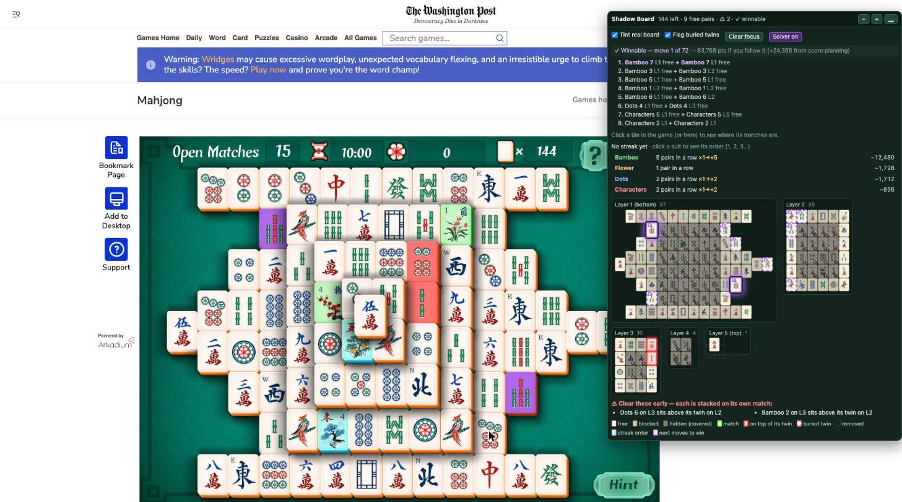
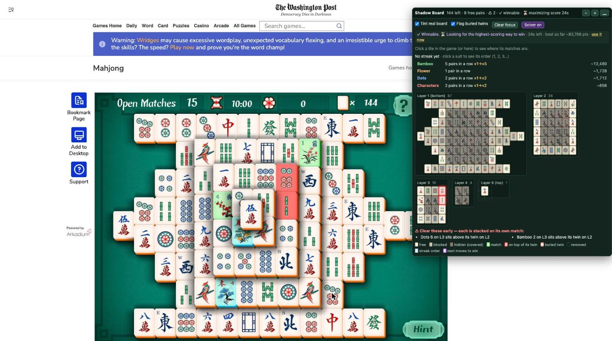
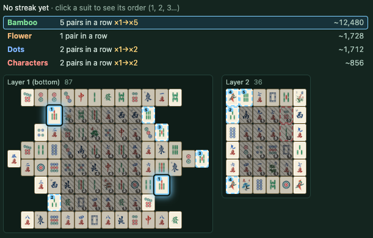
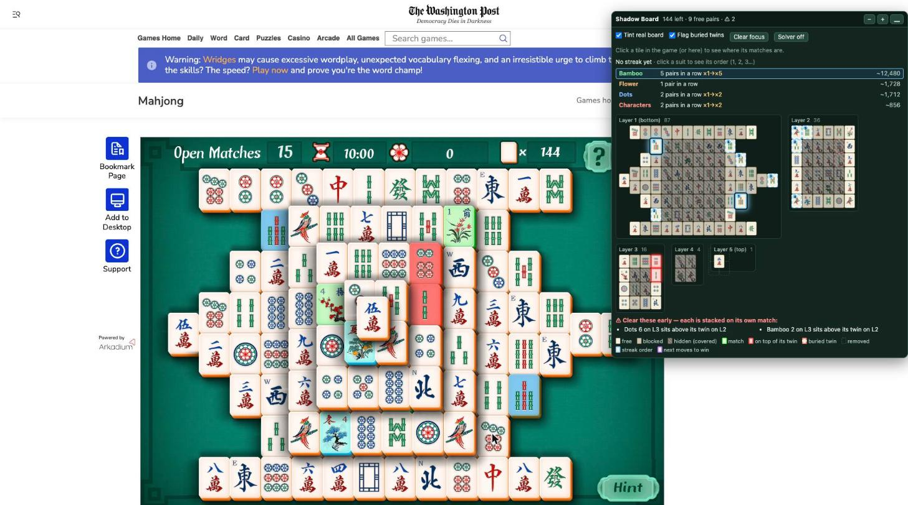

# WaPo Mahjong Chrome Extension Solver

An unofficial Chrome extension for the
[Washington Post Mahjong game](https://games.washingtonpost.com/games/mahjong)
(built by Arkadium). It adds a floating **Shadow Board** panel to the game page.
The panel:

- shows every tile, including the ones hidden under other tiles;
- tells you at the start whether the board can be won at all;
- if it can, lights up the next pair to play in purple, along a winning line that
  also aims for the highest score it can find.

It never makes moves for you. It reads the board and, if you turn the option on,
recolors tiles on the game board. The one time it changes the game is when you ask
it to [hunt for a high-scoring board](#high-score-hunt): then it deals new boards
for you, the same way the game's New Game button does.

> Not affiliated with The Washington Post or Arkadium. This is a personal project.
> The game's scoring rules below were worked out from the game's own code and
> aren't published by the site. A future game update could change them.



---

## Contents

1. [Install](#install)
2. [Game mechanics (not documented on the site)](#game-mechanics-not-documented-on-the-site)
   - [Tile types and point values](#tile-types-and-point-values)
   - [When a tile is free](#when-a-tile-is-free)
   - [Scoring](#scoring)
   - [Which order scores best](#which-order-scores-best)
3. [Using the extension](#using-the-extension)
   - [The Shadow Board panel](#the-shadow-board-panel)
   - [Streak planner](#streak-planner)
   - [Solver on](#solver-on)
   - [Solver off](#solver-off)
   - [High-score hunt](#high-score-hunt)
4. [How it works](#how-it-works)
5. [Troubleshooting](#troubleshooting)

---

## Install

The extension isn't in the Chrome Web Store, so you load it in Chrome's developer
mode. This takes about two minutes, and you only do it once.

### 1. Get the files

**Option A: download a ZIP (no tools needed)**

1. On this repository's GitHub page, click the green **Code** button, then
   **Download ZIP**.
2. Unzip it somewhere you'll keep it, such as your Documents folder.
   **Don't delete the folder afterward.** Chrome loads the extension from it every
   time it starts.

**Option B: clone with git**

```bash
git clone https://github.com/PittCaleb/WaPo-Mahjong-Chrome-Extension-Solver.git
```

### 2. Load it into Chrome

1. Open a new tab and go to `chrome://extensions`.
2. Turn on **Developer mode** with the switch in the top-right corner.
3. Click **Load unpacked** (top left).
4. Select the folder that contains `manifest.json`. That's the folder you unzipped
   or cloned. If the ZIP produced a folder inside a folder, pick the inner one.
5. **Mahjong Shadow Board** now appears in your extension list. Make sure its
   switch is on.
6. Optional: click the puzzle-piece icon in Chrome's toolbar and pin the extension.
   It works whether or not it's pinned.

### 3. Play

1. Go to <https://games.washingtonpost.com/games/mahjong>. If the page was already
   open, reload it.
2. The **Shadow Board** panel appears in the top-right corner. Until a board is on
   screen it says "waiting for a game…".
3. Click **Play!**, **New Game** or **Continue**. The panel fills in as soon as the
   tiles appear.

### Updating

- If you used the ZIP, download it again and replace the old folder's contents.
- If you cloned, run `git pull` in the folder.

Then go to `chrome://extensions`, click the **↻** (reload) icon on the extension's
card, and reload the Mahjong page.

### Uninstalling

Go to `chrome://extensions` and click **Remove** on the extension's card. You can
then delete the folder.

### Works on

Chrome and other Chromium browsers that support Manifest V3 extensions, such as
Edge and Brave, on desktop. It doesn't work on phones.

---

## Game mechanics (not documented on the site)

### Tile types and point values

The board has **144 tiles** in **7 suits**. Every suit has a **suit value**, which
sets how much its matches are worth.

| Suit | What the tiles look like | Values | Copies of each | Tiles | Pairs | Suit value |
|---|---|---|---|---|---|---|
| **Characters** | Red Chinese character 萬 with a number above it | 1–9 | 4 | 36 | 18 | **1** |
| **Dots** (circles) | Circles | 1–9 | 4 | 36 | 18 | **2** |
| **Bamboo** | Green sticks; the 1 is a bird | 1–9 | 4 | 36 | 18 | **3** |
| **Winds** | 東 East, 南 South, 西 West, 北 North | 4 | 4 | 16 | 8 | **4** |
| **Dragons** | 中 red, 發 green, white (blank frame) | 3 | 4 | 12 | 6 | **5** |
| **Flowers** | Flower paintings, numbered 1–4 | 4 | 1 | 4 | 2 | **6** |
| **Seasons** | Season paintings, numbered 1–4 | 4 | 1 | 4 | 2 | **7** |

**What matches what:**

- **Characters, Dots, Bamboo, Winds and Dragons:** a tile matches the other three
  tiles of the same suit *and* the same value. For example, Bamboo 7 matches only
  Bamboo 7.
- **Flowers and Seasons:** there's only one copy of each tile, so **any Flower
  matches any other Flower**, and **any Season matches any other Season**.

### When a tile is free

You can only pick up a **free** tile. A tile is free when both of these are true:

1. **Nothing is on top of it.** Even a tile that only partly overlaps it from the
   layer above counts.
2. **At least one side is open.** No tile touches it on the left, *or* no tile
   touches it on the right, in the same layer.

The board has **5 layers**: 87 tiles on the bottom, then 36, 16, 4, and 1 on top.
Many tiles are hidden at the start, so you can't see what's under the pile. The
extension can.

### Scoring

Every match scores:

```
points = 2 × suit value × tiles on the board before the match × streak
```

- **Tiles on the board** starts at 144 and drops by 2 with every match. The same
  match is worth more the earlier you make it.
- **Streak** starts at ×1. It goes up by 1 each time your match is the **same suit**
  as the match just before it. The values don't have to match: Bamboo 3, then
  Bamboo 7, then Bamboo 1 is a ×1, ×2, ×3 streak. As soon as you match a different
  suit, the streak goes back to ×1.

**Example: five Bamboo pairs in a row at the start of a game**

| Match | Tiles on board | Streak | Points |
|---|---|---|---|
| 1st Bamboo pair | 144 | ×1 | 2 × 3 × 144 × 1 = 864 |
| 2nd Bamboo pair | 142 | ×2 | 2 × 3 × 142 × 2 = 1,704 |
| 3rd Bamboo pair | 140 | ×3 | 2 × 3 × 140 × 3 = 2,520 |
| 4th Bamboo pair | 138 | ×4 | 2 × 3 × 138 × 4 = 3,312 |
| 5th Bamboo pair | 136 | ×5 | 2 × 3 × 136 × 5 = 4,080 |
| **Total** | | | **12,480** |

Make the same five matches with other suits mixed in between, so each one is a ×1
streak, and they total only **4,200**.

**End-of-game bonus:** **288 points for every pair you removed.** Clearing the
whole board gives 72 × 288 = **20,736**. The time left on the clock doesn't change
the bonus.

The game has no undo. A move is final.

### Which order scores best

Points multiply together, so a few rules matter much more than the rest.

**1. Long streaks are worth far more than anything else.** Each extra match in a
streak earns more than the one before. Points grow roughly with the *square* of the
streak's length:

| Opening streak (from a full board) | As one streak | Same pairs, streak broken every time |
|---|---|---|
| 5 pairs of Characters | 4,160 | 1,400 |
| 5 pairs of Dots | 8,320 | 2,800 |
| 5 pairs of Bamboo | 12,480 | 4,200 |
| 10 pairs of Dots | 29,040 | 5,400 |
| 10 pairs of Bamboo | 43,560 | 8,100 |
| All 8 Wind pairs | 38,784 | — |
| All 6 Dragon pairs | 28,840 | — |

**2. Do it early.** Every match is multiplied by the number of tiles left. A 10-pair
Bamboo streak scores 43,560 from a full board, but only 9,240 when 40 tiles are left.

**3. Choose high-value suits with many pairs.** Seasons (7) and Flowers (6) have the
highest values, but each has only 2 pairs, so their streak can't go past ×2. The
best streaks usually come from **Bamboo** (value 3, 18 pairs), **Winds** (4, 8
pairs), **Dragons** (5, 6 pairs) and **Dots** (2, 18 pairs). **Characters** (value 1)
are worth the least, so they're the best ones to spend on clearing space.

**4. Hold off on a streak until it can run long.** If only two Bamboo pairs are free
now but clearing one other pair frees three more, clear that pair first, then play
all five Bamboo pairs in a row.

**5. Winning matters most.** A full clear adds the 20,736 bonus, and a stuck board
leaves every remaining match unscored. A high-scoring line that can't be finished
is worth less than an ordinary win.

**6. The deal decides how high you can go.** The tiles are dealt at random. On some
boards a 10- or 12-pair streak can be opened up early. On most it can't. Record
scores come from lucky deals played well.

**Order of priority:** keep the board winnable → play long same-suit streaks while
the board is still full, favouring Bamboo, Winds, Dragons and Dots → use
low-value tiles (Characters) to unblock the next streak.

---

## Using the extension

### The Shadow Board panel



**Header**

- Tiles left.
- How many pairs you can match right now.
- How many "stacked on its twin" warnings there are (⚠).
- The solver's verdict.

**Header buttons**

- **−** / **+** make the panel smaller or larger.
- **▁** shrinks it to the header only.
- Drag the header to move the panel. It remembers its size and position.

**Options**

- **Tint real board:** colors tiles on the actual game board (purple, green, red),
  not only in the panel.
- **Flag buried twins:** turns the red warnings on or off.
- **Clear focus:** removes the green match highlighting.
- **Solver on / Solver off:** see [Solver on](#solver-on) and
  [Solver off](#solver-off).

**The layers.** Each of the 5 layers is drawn separately, so you can see tiles
underneath others.

| Looks like | Meaning |
|---|---|
| White inner edge | Free: you can play it now |
| Dimmed | Blocked: covered, or boxed in on both sides |
| Hatched, with a number badge | Hidden: the badge shows how many tiles sit on it |
| Dashed outline | Already removed |
| **Green glow** | A match for the tile you clicked |
| **Red tile** | Sits above its own twin, so clear it early |
| Red dashed outline | The buried twin under a red tile |
| **Purple, numbered 1–5** | The solver's next moves (1 = play now) |
| Blue, numbered | Play order for a streak you picked in the streak planner |

**Click any tile,** in the game or in the panel. Its matches (1 or 3 others, or the
other Flowers or Seasons) glow green everywhere, including hidden ones. The line
above the board lists each match's layer and whether it's FREE, blocked, or hidden
under N tiles.

**"Clear these early"** lists every tile that sits above its own twin. You must
clear those before you can reach the twin, or those two can never be matched.

**Streak planner:** lists the same-suit streaks you could play right now. Click a
suit to see its tiles numbered in play order. See [Streak planner](#streak-planner)
below.

### Streak planner

The streak planner sits just above the layers. It answers one question: **"If I
play only one suit, back to back, starting now, how long a streak can I make and
what is it worth?"**



**Reading a row**

```
Bamboo    5 pairs in a row ×1→×5    ~12,480
```

| Part | Meaning |
|---|---|
| **Bamboo** | The suit. Its colour matches the suit colours in the panel. |
| **5 pairs in a row** | The longest run of back-to-back Bamboo matches it found. It counts tiles that each match frees up, not only the ones free right now. |
| **×1→×5** | Your streak multiplier on the first and last match of the run. |
| **~12,480** | Points if you play the whole run now, without matching any other suit in between. |

It shows up to six suits, best-scoring first.

The line above the rows shows your current streak, for example **Current streak:
Bamboo ×3**. If a row is the same suit, its run continues that streak, so it starts
at ×4 rather than ×1 and is worth more.

**Click a suit to see the order.** The row gets a blue outline, and that suit's
tiles get blue numbered badges in the panel: **1** is the pair to play now, **2**
the next, and so on.

- **Pair 1** has a solid blue glow. Later pairs have a dashed blue border.
- **Later pairs can be blocked or hidden right now.** Earlier pairs in the run free
  them up.
- **On the game board,** only the next pair glows blue, so you always know which
  two tiles to click.



**As you play,** the suit stays selected. After each match the run is worked out
again from the new board, so the numbers and the blue pair move on to the next
step. Click the suit again to deselect it. Starting a new game also clears it.

**With the solver on,** both can light up at once. The solver's purple suggestion
takes priority:

- **On the game board,** a tile that's in both shows purple.
- **In the panel,** tiles among the solver's next five moves show the purple
  number instead of the blue one.

If you're following the solver, you can ignore the blue. It's most useful with the
solver off, or when the solver says a board is **✗ not winnable** or **? no win found
yet** and you want to score as much as possible.

**Things it doesn't do**

- **It doesn't check whether the board can still be won.** A big Bamboo streak can
  leave you stuck later. The solver checks this; the streak planner doesn't.
- **It looks at one suit at a time.** It won't suggest clearing a Characters pair
  first to set up a longer Bamboo run. The solver's score search does plan that
  way.
- **It searches a limited number of play orders per suit, so it stays fast.** Very
  rarely, a slightly longer run exists than the one shown.

### Solver on

The solver is on by default, and the **Solver on** button is purple. As soon as a
board appears, it does two things.

**Step 1: can this board be won?** It searches every possible line of play, using
the hidden tiles too, which you can't see in the game. The verdict appears in the
header:

| Verdict | Meaning | What the purple pair is |
|---|---|---|
| **✓ winnable** | It found a line that clears the whole board | The next move on that winning line |
| **✗ not winnable** | It proved no line clears the board. The panel gives the reason, such as two sets stacked so each needs the other cleared first | The move that starts the best-scoring streak right now |
| **? no win found yet** | It hit its 45-second limit without a win or a proof | Best move for points. It searches again after every move you make |

**Step 2: the highest-scoring way to win.** Once a board is known to be winnable,
it spends up to **30 seconds** looking for the highest-scoring line that still
clears the board:

- The header shows a countdown ("⏳ maximizing score 24s").
- The panel shows the best score found so far.
- Click **use it now** to stop early and play the best line found so far.

To find that line, it runs two searches and keeps whichever scores higher:

- **Streak planner search:** builds the line from whole same-suit streaks. At
  each point it finds the longest high-value streak available. It takes that
  streak only if it can still prove a win afterward. Otherwise it tries a
  shorter piece of the streak, or another one.
- **Pair-by-pair search:** builds the line one pair at a time, taking the
  highest-scoring pair that still leaves a win.

Both repeat many times with some randomness, and sometimes start over, to avoid
getting stuck on one idea.

**Then follow the purple pair.** The panel shows "move N of 72", the next 8 moves,
and roughly how many points you'll finish with if you follow it, including the
clear bonus.

- **If you play a different pair, or the game shuffles,** it notices and plans
  again from where you are.
- **Before any plan is shown,** the whole line is replayed against the game's own
  tile rules. A line that fails that check is never shown.

**Results on random deals of this layout:**

- About **87%** were proven winnable, most within a second. The rest were proven
  unwinnable or ran out of time.
- Following only the purple pair cleared every board the solver called winnable.
- With the 30-second search, a typical winnable board scored about **80,000
  points**, including the 20,736 clear bonus.
- That was about 13% more points from matches than an earlier 5-second search.
  Boards that allow long streaks gained much more.

### Solver off

Click **Solver on** to switch it to **Solver off**. The search stops and the purple
highlighting disappears. Everything else keeps working:

- the layer view of hidden tiles;
- green match highlighting;
- red "stacked on its twin" warnings;
- the streak planner, with its blue numbered tiles.

Use this if you'd rather plan your own game and just see what's hidden. The streak
planner only looks at what's playable right now, though. It can't tell whether a
streak will leave the board unwinnable. With the solver off, it's easy to score big
early and then get stuck.

### High-score hunt

Some deals allow far higher scores than others, because the tiles happen to line up
for long streaks. The hunt keeps dealing new boards until it finds one that can beat
your best.

1. Type your high score into **My high score** at the top of the panel. It's saved
   for next time.
2. Click **Hunt for a better board**. The button turns gold and reads **Stop hunt**.
   The solver turns on if it was off.
3. Leave the game tab open and on screen. A status line keeps you posted:

   > 🔎 Searching board **37** (00:41:12) for a new high score above **101,568** ·
   > last board ~81,200

For each board it deals, the hunt runs the solver and checks the best winning score
it can find, including the 20,736 clear bonus.

- **It beats your score:** the hunt stops at once. You get a green "🎉 Found one!"
  banner with the score, board count and time taken, a short chime, and a flashing
  tab title until you click or press a key. The score search keeps running for its
  full 30 seconds, so the purple plan you follow is the best it can find for that
  board.
- **It doesn't:** it deals the next board. To keep moving, it gives up on a board
  early when:
  - no winning line turns up within 10 seconds ("no quick win");
  - the board is proven unwinnable ("not winnable");
  - after 10 seconds of score search, the best line is still under 90% of your
    score.

Expect about 6 boards a minute. Most boards land between 70,000 and 90,000 points,
so a high target can take a long while. The hunt never makes moves. Be aware of
two things:

- **It abandons boards.** If you start a hunt partway through a game, that game is
  thrown away. Skipped boards may also count as started games in the site's stats.
- **The tab must be on screen.** Chrome freezes the game's animation in background
  tabs, so no new boards get dealt until you come back. Clicking into another
  window is fine. To use your computer while it hunts, drag the game tab into its
  own window and leave it uncovered.

Click **Stop hunt** any time to stop. The board in front of you stays put.

---

## How it works

The game runs inside an iframe from `arenacloud.cdn.arkadiumhosted.com`. It's built
with the Phaser game engine.

- **`frame.js`** runs inside that game iframe, in the page's own JavaScript context.
  - It finds the running game (`window.__arenax_v1__.MahjongGame`) and reads the
    board's tile list straight from the game's memory.
  - Each tile's data includes its layer, column, row, suit, value and neighbors.
    Reading it is more reliable than reading pixels. It works with New Game,
    Continue and shuffles, and never misses a tile.
  - It uses the game's own rules for "free" and "matches".
  - It sends a snapshot to the panel up to 5 times a second, but only when
    something changed.
  - It recolors tile sprites when **Tint real board** is on.
- **`solver.js`** is the search engine. It has no page code, so it also runs in
  Node for testing. It uses:
  - a depth-first search with a memory of dead positions it has already proven;
  - "safe" forced moves;
  - early detection of sets that can never be finished;
  - restarts with a slightly different move order.
  It runs in small slices so the game never freezes.
- **`top.js` / `top.css`** draw the panel on the Washington Post page. The two
  parts talk through `postMessage`, and each checks where messages come from.

It doesn't send data anywhere, track you, or need any permissions beyond running
on those two sites.

---

## Troubleshooting

**The panel says "waiting for a game…".** Start or continue a game. If a board is
showing and it still says this, Arkadium may have released a new version of the
game that changed its internal names. The code expects build `Release-40`.

**The game's tile faces went blank.** The game pauses whenever you click outside it,
including on the panel. Click an empty green area of the game board to bring the
tiles back.

**Nothing changed after I updated the files.** Click **↻** on the extension's card
at `chrome://extensions`, then reload the Mahjong page.

**Chrome warns about developer-mode extensions.** That's normal for extensions
loaded with **Load unpacked**. You can dismiss it.
